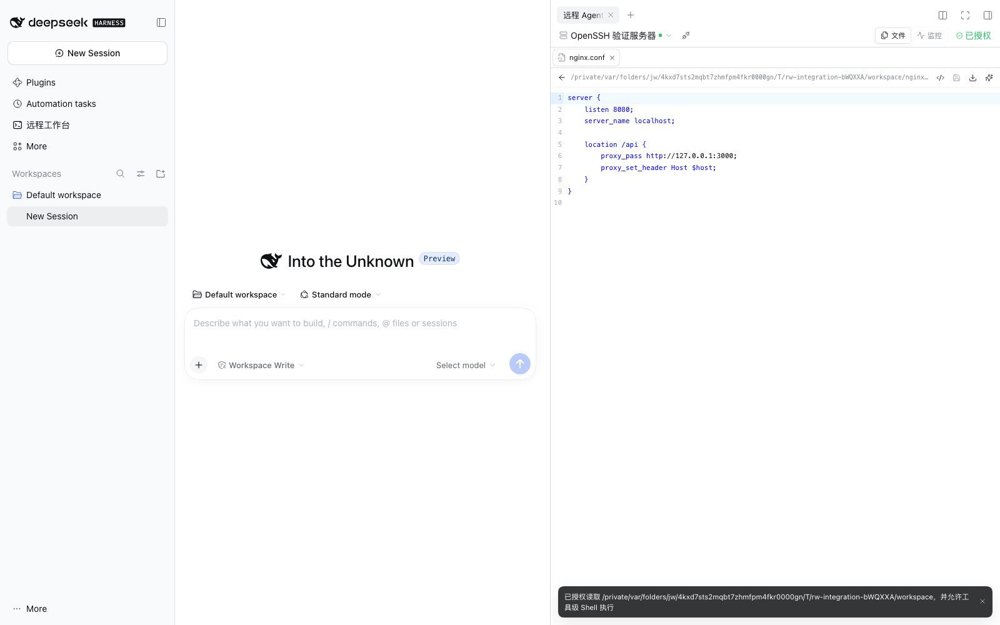
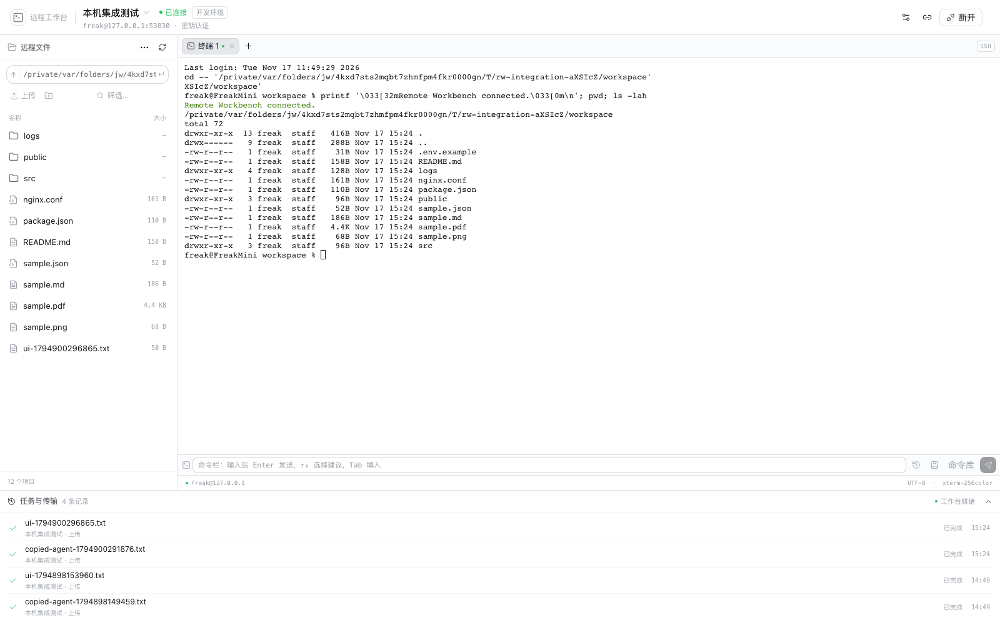
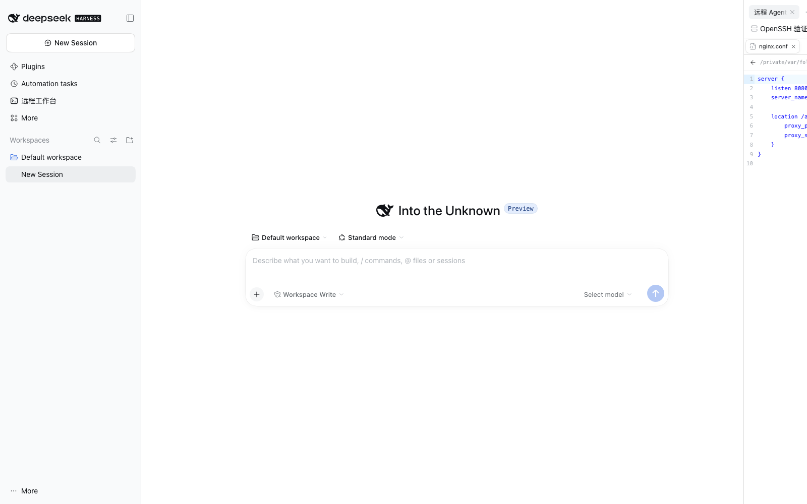
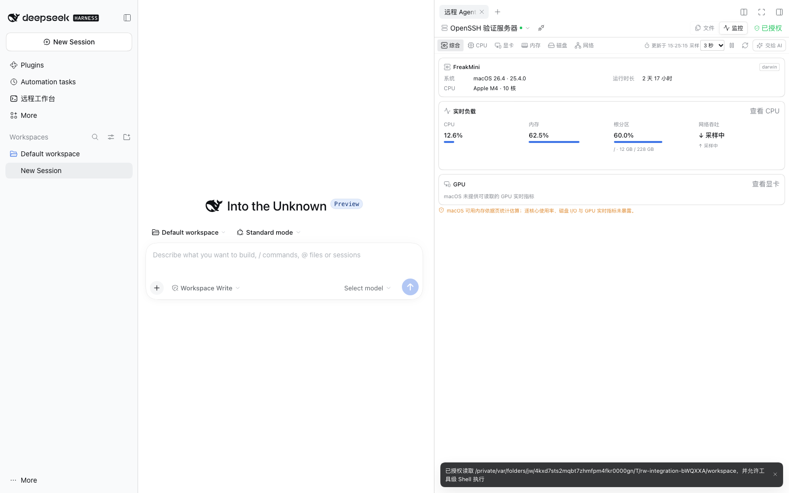

# Remote Workbench

**DSH 原生右侧栏里的 AI 远程工作台：SSH、SFTP、监控与文档编辑，和普通对话并排。**

[](CHANGELOG.md)
[](https://github.com/deepseek-ai/deepseek-harness)
[](LICENSE)
[](#开发与验证)

Remote Workbench 是 [DeepSeek Harness](https://github.com/deepseek-ai/deepseek-harness)（DSH）的第三方插件。它在 DSH **自带的右侧边栏**里打开一个远程 Agent：中央继续使用原生对话，右侧查看服务器监控、浏览和编辑远程文件，随时把文件或监控摘要交给当前会话。另有一个独立工作台，保留 SSH 终端、命令栏、隧道等完整操作。

- 需要 **DSH ≥ 0.2.2-rc.3 < 0.3.0**（原生右侧栏扩展接口）。
- 支持 macOS / Linux 上的 DSH Host；浏览器端只允许 loopback 访问。
- 不修改 DSH 核心，不替换全局 `fs` / `subprocess`，不发送遥测。



## 目录

- [能力](#能力)
- [安装](#安装)
- [开始使用](#开始使用)
- [Agent 工具](#agent-工具)
- [安全模型](#安全模型)
- [数据与限制](#数据与限制)
- [开发与验证](#开发与验证)
- [项目结构](#项目结构)
- [文档](#文档)
- [License](#license)

## 能力

**原生右侧 Agent（主入口）**

- 通过官方 `sidebarRightTabs` / `sidebar.right.pane.tab` 合同嵌进真正的 DSH 右侧栏，跟随原生开关与放大。
- 绑定当前会话；切换文件、监控或普通对话时组件保持挂载，草稿不丢。
- 这个模式里**没有终端、命令栏或第二套聊天**，只有监控与远程文件。
- 双击文件、右键“在右侧栏打开”或选中后点击按钮，文件会在会话旁的右栏打开，而不是占用工作台自己的列。

**资源监控**

- 综合、CPU、显卡、内存、磁盘、网络六个视图，历史趋势、暂停与 3/5/10/30 秒刷新间隔。
- Linux 通过固定的只读 SSH 通道读取 `/proc`、sysfs、`df` 等数据，无需远程 Agent 或 sudo；NVIDIA / AMD 依赖已安装的驱动与读取权限。
- Windows 通过固定的只读 PowerShell 采集 CPU、内存、磁盘、网卡和 `nvidia-smi`，输出为 UTF-8。不提供 CPU 温度、IO 等待和磁盘忙碌率。
- macOS 提供基础指标，缺失项明确显示“不可用”，不把未知数据当成 0。

**文档工作区**

- 多文件标签、CodeMirror 语法高亮、查找替换与 `⌘S` 保存。
- Markdown 源码 / 预览 / 分屏，预览经过 DOMPurify 清理；相对图片走当前主机，外部图片需点击加载。
- PDF 分页、适应宽度、缩放、文字批注、页面旋转、已有 AcroForm 表单填写；保存经 SFTP 原子替换，PDF worker 独立加载，不污染 DSH 自带的 worker 全局。
- 图片与浏览器支持的音视频预览；未知类型提供下载。

**文件与连接**

- SFTP 浏览、隐藏文件、筛选、多选、右键菜单、新建目录、重命名、删除文件 / 空目录。
- 新建文本、复制、移动、`chmod`；多文件上传、拖放上传、流式下载、取消与任务记录。
- 文本 1 MiB 内 UTF-8 编辑，Diff、SHA-256 内容冲突检查、保留权限、原子重命名提交。
- 主机分组、搜索、新建 / 编辑 / 删除、私钥或密码认证、逐跳独立认证的 ProxyJump、SSH Config 基础导入。
- 首次连接核对并保存 SHA-256 主机指纹；指纹变化会阻止连接。

**独立工作台（次要入口）**

- 文件与真实 SSH PTY 同屏，多标签终端、面板切换不结束远端进程、刷新后重新附着。
- 命令栏、命令补全、显式发送历史、片段库与服务器级命令记忆。
- 监听 DSH Host `127.0.0.1` 的本地端口转发。

**外观**

- 颜色、圆角、字体、字号与阴影全部取自 DSH 的 `--dsw-*` 主题变量与字号设置，明暗与“跟随系统”随宿主切换；终端调色板同样读取宿主主题。
- 面板内导航只在顶部：主机切换、搜索、连接状态和主要操作集中在顶栏下拉弹层，没有常驻左侧主机列表。

| 工作台（终端 + 文件）                    | 右侧 Agent                                       | 监控                                           |
| ---------------------------------------- | ------------------------------------------------ | ---------------------------------------------- |
|  |  |  |

## 安装

从 [Releases](https://github.com/Freakz2z/dsh-remote-workbench/releases) 下载 `dsh-remote-workbench-0.2.0.tgz`，然后安装到目标 profile：

```sh
# 桌面应用
dsh plugin --profile desktop add /absolute/path/dsh-remote-workbench-0.2.0.tgz

# Web / 无头
dsh plugin --profile web add /absolute/path/dsh-remote-workbench-0.2.0.tgz
```

桌面应用内置的 CLI 位于：

```text
/Applications/DeepSeek Harness.app/Contents/Resources/runtime/cli/bin/dsh
```

安装完成后**完全退出并重新打开 DSH**（⌘Q，而不是只关窗口）。客户端模块在启动时装配，只刷新页面不会加载新版本。

也可以用源码直接安装：

```sh
npm ci && npm run build
dsh plugin --profile desktop add /absolute/path/to/dsh-remote-workbench
```

卸载：

```sh
dsh plugin --profile desktop remove dsh-remote-workbench
```

## 开始使用

1. 在普通 DSH 会话中点击标题栏的**远程 Agent**按钮；或打开原生右侧栏，从引导页 / **+** 菜单选择 **远程 Agent**。
2. 首次使用可直接在右栏新建连接：主机、端口、账号、认证方式（私钥或密码）、默认远程目录。保存后点击“连接”，核对 SHA-256 指纹并信任。
3. 顶部主机名是服务器切换器：搜索、分组、切换、连接、编辑、从 SSH Config 导入都在这个下拉里。
4. 在 **文件** 中双击打开文档，编辑或预览；在 **监控** 中查看六类资源。文件与监控摘要可以先预览，再交给当前会话。
5. 需要 Agent 使用远程工具时，在右栏授权当前会话：默认只读，可单独开启写入与工具级 Shell 执行；授权按会话、主机、目录和连接版本隔离。

密码与私钥口令输入一次后会保存到 DSH 凭据记录，之后重连不再询问；可在编辑连接对话框里“忘记已保存凭据”。

## Agent 工具

注册 8 个工具。除 `rw_connect` 外都需要当前会话的对应授权，路径必须位于授权目录内，并匹配连接版本。

| 工具           | 作用                                    | 授权              |
| -------------- | --------------------------------------- | ----------------- |
| `rw_hosts`     | 列出当前会话已授权的主机与权限          | 任意授权          |
| `rw_resources` | 读取 CPU / 内存 / 磁盘 / 网络等真实指标 | 读取              |
| `rw_list`      | 列出目录                                | 读取              |
| `rw_read`      | 读取远程文本文件                        | 读取              |
| `rw_write`     | 原子写入远程文件（etag 冲突检查）       | 写入              |
| `rw_exec`      | 执行命令并返回输出                      | Shell 执行        |
| `rw_tasks`     | 查看传输与命令任务记录                  | 任意授权          |
| `rw_connect`   | 用已保存凭据连接已授权主机              | 读取 + 已保存凭据 |

`rw_connect` 不接收、不存储、不返回密码；密码认证没有已保存凭据时会要求先在 UI 手动连接一次。

## 安全模型

- **只在本机监听**：HTTP 与终端接口仅允许 loopback，校验 Host、Origin 与页面令牌；远程部署的浏览器接入尚未开放。
- **凭据不进配置**：密码与私钥口令保存在 `remote-workbench/` 下的 DSH 凭据记录，不写入插件 `state.json`，不出现在工具参数、返回值或日志里；删除连接会同时删除记录。
- **授权最小化**：读取、写入、Shell 执行分别授权，按会话 / 主机 / 目录 / 连接版本隔离；修改连接配置或重启 Host 后需要重新授权。
- **主机身份固定**：首次连接必须核对 SHA-256 指纹，之后指纹变化会阻止连接。
- **Shell 不是沙箱**：终端从授权目录启动，但拥有远端账号的系统权限；只读或写入授权不会自动开放 Shell。
- **无遥测**：插件不发送任何遥测；只有你主动点击“交给当前 Agent”时，内容才会进入当前 DSH 会话。

## 数据与限制

- 主机配置、可信指纹与最近 200 条任务记录位于 `$DSH_HOME/remote-workbench/state.json`（默认 `~/.dsh/remote-workbench/state.json`），目录 `0700`、文件 `0600`。
- 命令库与服务器级历史保存在同一配置中；只记录显式发送的命令，不抓取原始 PTY 密码输入，明显含凭据的命令不会进入记忆。资源样本只保留在内存。
- 文本编辑仅支持 1 MiB 内 UTF-8；二进制预览和 PDF 保存上限 25 MiB；其他格式可下载。HTML / SVG 只作为源码处理。
- PDF 编辑包括批注、表单与旋转，不包含任意排版修改、OCR、数字签名或嵌入字体替换；中文批注以图像方式嵌入。
- macOS 不提供逐核心、磁盘 I/O 与 GPU 实时指标；Linux 速率需要两个采样点。
- Windows 不提供 CPU 温度、IO 等待和磁盘忙碌率；磁盘与网络速率需要两个采样点。
- 上传暂不支持目录递归与断点续传；删除目录仅限空目录。
- 保存会检查内容变化，但 SFTP 内容核对与重命名不是跨外部进程的事务；服务器不支持原子重命名时会拒绝替换，不先删除原文件。
- 命令不会自动重放。连接中断、取消或超时后，已发出的命令可能显示“待核对”，表示远程效果未确认，不能当作已撤销。
- 收起面板与刷新浏览器可保留 Host 中仍活跃的终端；SSH 断线、远端 Shell 退出或 Host 重启后不承诺恢复同一进程。

### 旧凭据导致 DSH 启动失败

如果启动日志报告 `credential key segment` 或未知的 `ssh-credentials` 类型，先退出 DSH 并备份 `$DSH_HOME/.credentials.yaml`（默认 `~/.dsh/.credentials.yaml`）。修复后的插件会保存合法的新记录，但 DSH 在加载插件之前就会读取旧文件。

在 `records` 下迁移 `remote-workbench/` 中类型为 `ssh-credentials` 的旧记录。

1. 将 `kind` 改为 `grant`，保留 `payload`。
2. 如果 `remote-workbench/` 后的主机 ID 不符合 `^[a-z][a-z0-9-]*$`，用 `node -p "Buffer.from('实际主机ID', 'utf8').toString('hex')"` 生成后缀。新记录名为 `remote-workbench/host-` 加上这个后缀。
3. 保存文件，用修复后的插件重新打开 DSH。凭据文件和备份均保存在本机。

## 开发与验证

需要 Node.js ≥ 24.9。

```sh
npm ci
npm run dev                 # 本机独立预览 http://127.0.0.1:4720
                            # http://127.0.0.1:4720/?agent=1 为右栏组件预览
npm run typecheck
npm test                    # 37 项：真实 OpenSSH / SFTP、HTTP 边界、资源、凭据与授权
npx playwright install chromium
npm run test:ui             # 12 项：浏览器交互、响应式、主题与草稿
npm run test:dsh            # 24 项：隔离 profile 中安装真实 DSH 并验收
npm run build               # lib/index.js + lib/client.js
npm pack --pack-destination releases
```

`npm run dev` 默认连接真实主机；使用自动生成的本机 OpenSSH 测试服务器：

```sh
RW_FIXTURE=1 npm run dev
```

测试夹具生成临时主机密钥与客户端密钥，监听 `127.0.0.1` 高位端口，文件位于独立临时目录。它以当前系统账号运行，不是隔离远程命令的安全沙箱；结束开发进程时关闭 sshd 并清理临时目录。需要 `/usr/sbin/sshd` 与 `/usr/bin/ssh-keygen`。

`npm run test:dsh` 使用独立 `DSH_HOME` 创建测试 profile、安装插件并验证真实 DSH 装配。默认使用 macOS 已安装的 DSH CLI，可通过 `DSH_BIN` 指定其他路径。测试辅助接口只存在于该测试 profile，未包含在安装包中。

## 项目结构

```text
src/client/        DSH 右栏 Agent、独立工作台、xterm、编辑器、监控与主题
src/host/          SSH 连接、SFTP、PTY、隧道、任务、凭据、权限与 HTTP 边界
src/shared/        Host / Client 共享的数据契约
src/index.ts       DSH Host 生命周期、会话桥接与工具注册
scripts/           构建、独立开发与真实 DSH 验证
tests/             OpenSSH、HTTP、浏览器与 DSH 测试夹具
docs/              设计说明、发行记录与预览图
```

插件入口与打包遵循 DSH 官方 [Bundle 文档](https://github.com/deepseek-ai/deepseek-harness/blob/master/docs/user/develop/basic/publish.zh.md)与 [Client module contract](https://github.com/deepseek-ai/deepseek-harness/blob/master/packages/client/modules/README.md)。SSH 底层使用 [ssh2](https://github.com/mscdex/ssh2)。

## 文档

- [0.2.0 发行记录](docs/RELEASE-0.2.0.md)
- [0.2 实现与验证结果](docs/DSH-WORKSTATION-0.2-RESULT.md)
- [HTTP / WebSocket API](docs/WORKSTATION-0.2-API.md)
- [产品定义](docs/PRODUCT.md) · [视觉规范](docs/style.md)
- [变更日志](CHANGELOG.md) · [安全策略](SECURITY.md)

## License

[MIT](LICENSE)。打包进产物的第三方代码版权与许可见 [THIRD_PARTY_NOTICES.md](THIRD_PARTY_NOTICES.md)。
